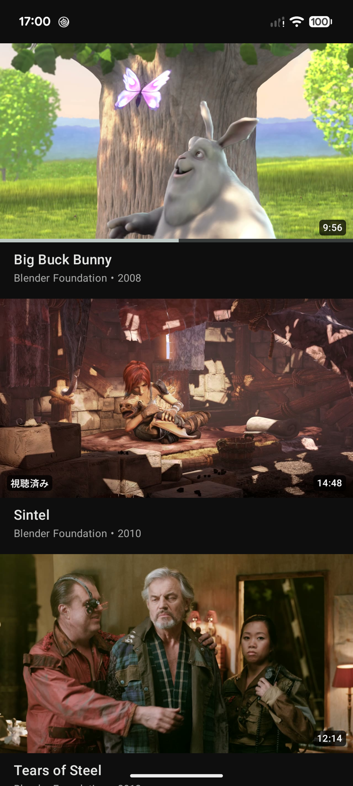
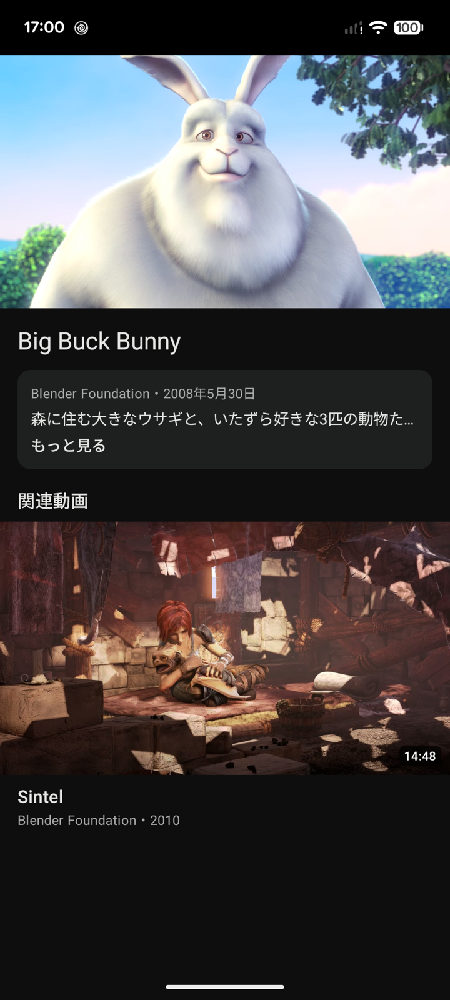
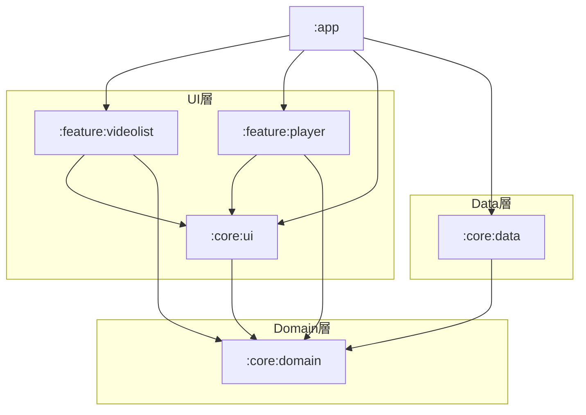

# video-streaming-android

一覧画面と再生画面の2画面で構成される、ポートフォリオ用のシンプルな動画配信アプリです。

  
  

## 機能

- 動画一覧の表示
- HLS形式の動画の再生
- 再生位置の保存と続きから再生（一覧に、プログレスバー・視聴済みバッジを表示）
- 関連動画の表示と動画の切り替え

## 技術スタック

| 項目 | 採用したもの |
|---|---|
| 言語 | Kotlin |
| UI | Jetpack Compose・Material 3 |
| 画面遷移 | Navigation 3 |
| DI | Hilt |
| 再生 | Media3（ExoPlayer） |
| 通信 | Retrofit 3・OkHttp・kotlinx.serialization |
| 画像の読み込み | Coil 3 |
| 端末への保存 | Room 3 |
| 非同期処理 | Kotlin Coroutines・Flow |
| テスト | Kotest 6・Turbine・Compose UI Test |
| 静的解析 | Android Lint・ktlint（Spotless）・Compose Lints |
| CI | GitHub Actions |
| 動画の配信 | Cloudflare R2（HLS） |

## アーキテクチャ

- 目的ごとにモジュールを分けています。画面は`:feature:*`、複数の画面で使うUIは`:core:ui`、モデル・ビジネスロジックは`:core:domain`、データの取得・保存は`:core:data`に置き、画面遷移は`:app`でつなぎます
- Repositoryのinterfaceは`:core:domain`に置き、`:core:data`が実装します。`:core:domain`は、Androidに依存しない純粋なKotlinのモジュールです
- 各モジュールに共通するビルドの設定は、`build-logic`のConvention Pluginにまとめています

## 環境

Android Studio Rabbit 2 | 2026.2.2 Patch 1を使用

## クレジット

アプリで再生する動画は、Blender Foundationの次の作品を[CC BY 3.0](https://creativecommons.org/licenses/by/3.0/)のもとで使用しています。

| 作品 | 著作権表示 |
|---|---|
| Big Buck Bunny | (c) copyright 2008, Blender Foundation / www.bigbuckbunny.org |
| Sintel | © copyright Blender Foundation \| durian.blender.org |
| Tears of Steel | (CC) Blender Foundation \| mango.blender.org |

改変した内容：HLS形式に変換し、3つの画質（360p・720p・1080p）に再エンコードしました。サムネイルは、本編の1場面を16:9に切り抜いたものです。
